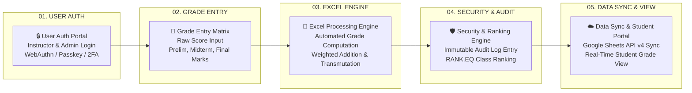
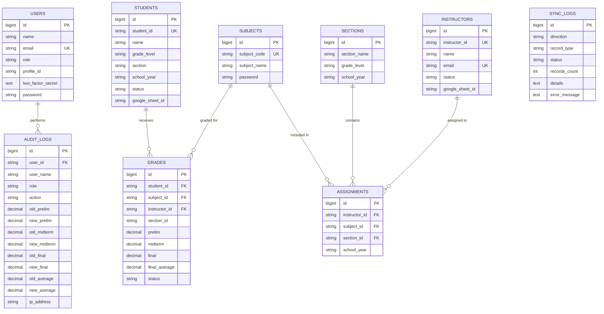
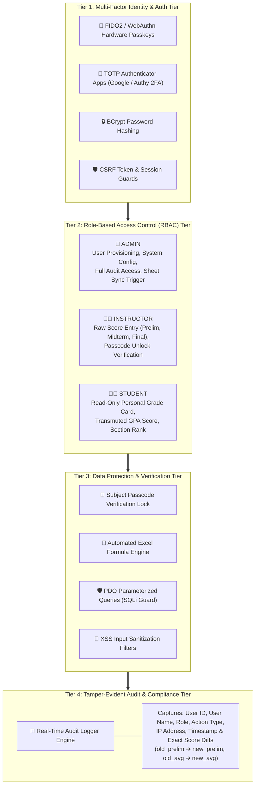
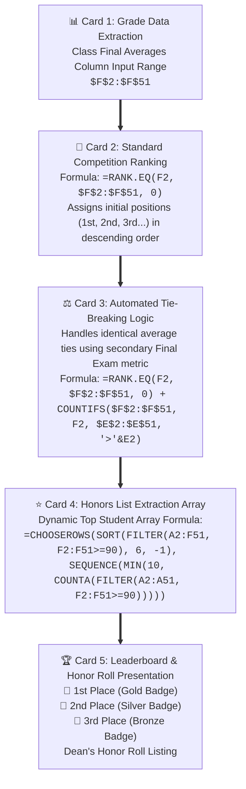
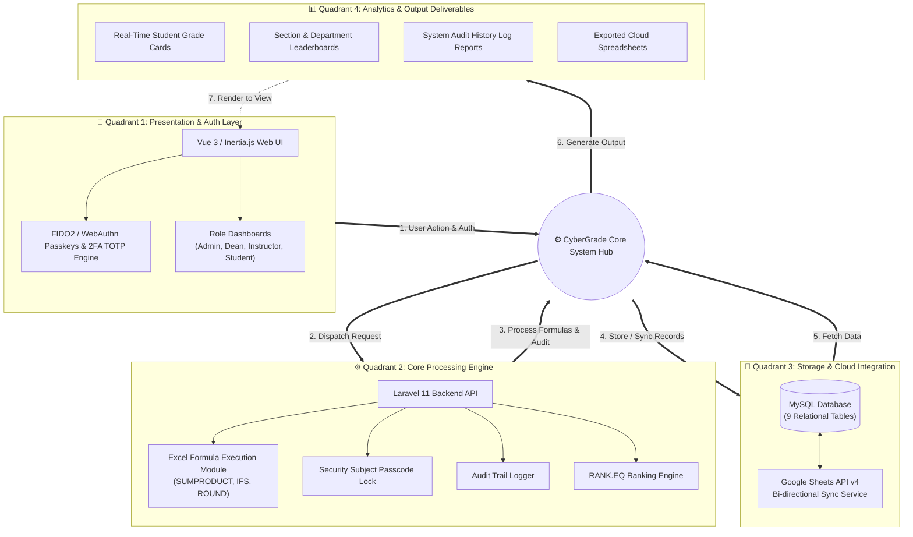

# 📊 CyberGrade — Complete Mermaid Diagrams Reference

This document contains all 6 architecture, process, security, and ranking diagrams converted directly into executable **Mermaid** code blocks.

---

## 1. 🏗️ Diagram 1: System Design Flowchart

---

## 2. 🗄️ Diagram 2: Database ERD Diagram

---

## 3. 🛡️ Diagram 3: Security Architecture & RBAC

---

## 4. 🧮 Diagram 4: Grade Computation Pipeline

```mermaid
flowchart LR
    subgraph STEP1 ["Step 1: Raw Scores Input Card"]
        S1_A["Prelim (30% weight)"]
        S1_B["Midterm (30% weight)"]
        S1_C["Final (40% weight)"]
        S1_V["Score Range Validation:<br/>0.00 – 100.00"]
    end

    subgraph STEP2 ["Step 2: Excel Calculation Engine Card"]
        S2_A["Weighted Addition:<br/><code>=(C2*0.30) + (D2*0.30) + (E2*0.40)</code>"]
        S2_B["Excel SUMPRODUCT:<br/><code>=SUMPRODUCT(C2:E2, $C$1:$E$1)</code>"]
        S2_C["Missing Score Guard:<br/><code>=IF(COUNTA(C2:E2)=0, 'Pending', ROUND(SUM(C2:E2)/COUNTA(C2:E2), 2))</code>"]
    end

    subgraph STEP3 ["Step 3: Grade Transmutation & GPA Lookup Card"]
        S3_MAP["IFS Transmutation Mapping Table:<br/>97–100% ➔ 1.00 (A+)<br/>93–96% ➔ 1.25 (A)<br/>89–92% ➔ 1.50 (A-)<br/>85–88% ➔ 1.75 (B+)<br/>80–84% ➔ 2.00 (B)<br/>75–79% ➔ 2.50 (C)<br/>70–74% ➔ 3.00 (D)<br/>&lt;70% ➔ 5.00 (F)"]
        S3_F["Formula:<br/><code>=IFS(F2>=97, 1.00, F2>=93, 1.25, ..., TRUE, 5.00)</code>"]
    end

    subgraph STEP4 ["Step 4: Final Evaluation & Status Output Card"]
        S4_AVG["Computed Final Average & GPA Mark"]
        S4_STATUS["Pass/Fail Status Badge:<br/><code>=IF(F2>=75, 'PASSED', 'FAILED')</code>"]
        S4_B1["🟩 PASSED Badge (≥ 75.00)"]
        S4_B2["🟥 FAILED Badge (&lt; 70.00)"]
        S4_B3["🟨 PENDING Badge (Missing Marks)"]
    end

    STEP1 ==> STEP2
    STEP2 ==> STEP3
    STEP3 ==> STEP4
```

---

## 5. 🏆 Diagram 5: Ranking Engine Flowchart

---

## 6. 🌐 Diagram 6: Complete System Architecture Overview

