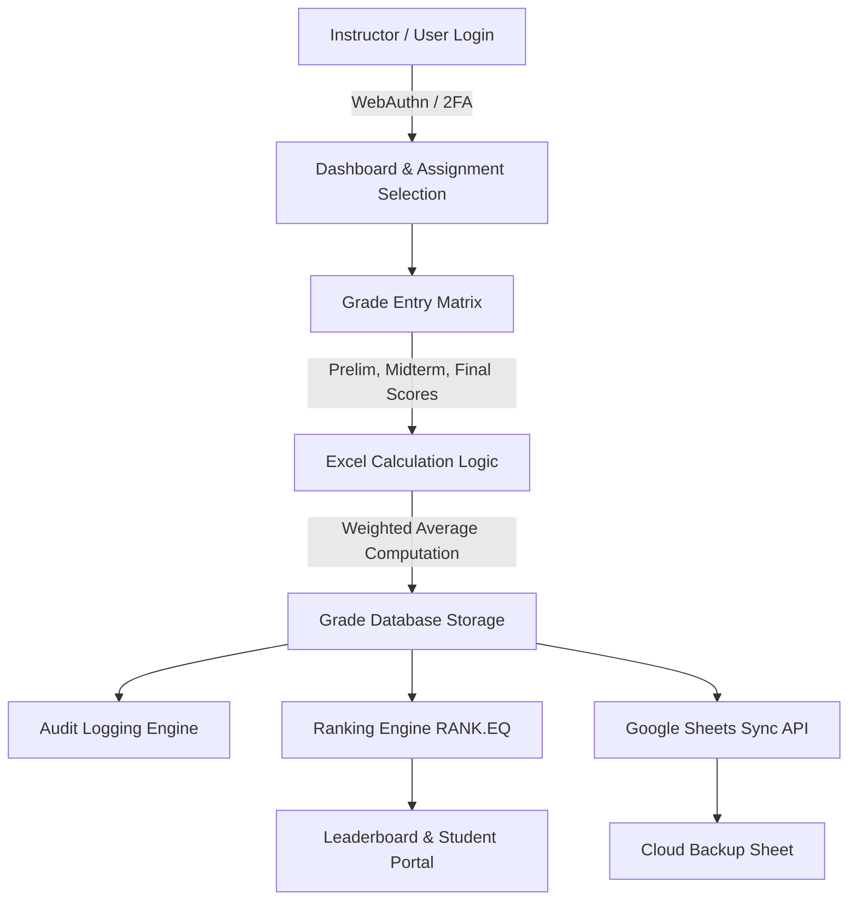

# Online CyberGrade: A Secure Role-Based Grade Administration and Ranking System

---

## 📋 Executive Overview & Student Deliverables Matrix

**Online CyberGrade** is a robust, web-based grade administration, security, and ranking system designed for educational institutions. It integrates automated grade calculations using standard Excel formulas, role-based security access control (RBAC), multi-factor authentication (2FA / Passkeys), audit logging, real-time Google Sheets bi-directional sync, and dynamic student performance ranking.

### Deliverables Summary Table

| Deliverable | Description | Primary Components |
| :--- | :--- | :--- |
| **System Design** | Architecture & Process Workflows | System Architecture Diagram, End-to-End Grade Flowchart, **Canva Diagram Prompts** |
| **Database Design** | Data Structures & Entity Relationships | 9 Database Tables, Foreign Key Matrix, ERD Diagram, **Canva ERD Prompts** |
| **Security Design** | Authentication, Authorization & Auditing | Role-Based Access Control (RBAC), Passkeys/2FA, Audit Logs, **Canva Security Prompts** |
| **Grade Module** | Assessment & Term Computation | Prelim, Midterm, Final & Final Average Excel Formulas (`SUMPRODUCT`, `AVERAGE`, `IFS`, `ROUND`) |
| **Ranking Module** | Academic Ranking & GPA Logic | Excel Ranking Formulas (`RANK.EQ`, `SORT`, `FILTER`, `COUNTIFS`), Tie-breaking Rules |
| **Documentation** | Operational & Technical Guide | End-to-End System Guide, User Role Workflows, Maintenance & Troubleshooting |

---

## 1. 🏗️ System Design

### 1.1 High-Level Architecture
The system follows a modern multi-tier model combining a **Laravel Framework (PHP 8.2+) / Inertia.js (Vue.js 3)** frontend and backend, backed by a **MySQL Database**, **Google Sheets API v4 Integration**, and **WebAuthn / Passkey** security engine.

```
       [ Client Browser (Vue 3 / Inertia) ]
                       │
             HTTPS (SSL / TLS 1.3)
                       │
       ┌───────────────▼────────────────┐
       │   Laravel Middleware & RBAC    │
       ├────────────────────────────────┤
       │ WebAuthn / 2FA / Session Auth  │
       └───────────────┬────────────────┘
                       │
       ┌───────────────┴────────────────┐
       │     CyberGrade Core Modules    │
       │ (Grades, Ranking, Audit, Sync) │
       └───────┬────────────────┬───────┘
               │                │
      ┌────────▼──────┐  ┌──────▼─────────────┐
      │ MySQL Database│  │ Google Sheets Sync │
      └───────────────┘  └────────────────────┘
```

---

### 1.2 End-to-End Process Flowchart

```
[Instructor Log In] ──► [Select Assigned Section/Subject] ──► [Enter Raw Scores (Prelim/Midterm/Final)]
                                                                          │
                                                                          ▼
[Student Grade View] ◄── [Audit Log Recorded] ◄── [Recalculate Rank] ◄── [Excel Calculation Engine]
```

---

### 🎨 Canva Diagram Prompt 1: System Design Flowchart

> **Copy & Paste this prompt into Canva AI (Magic Design / Whimsical / Canva Elements / Napkin AI):**
>
> `"Design a high-resolution, modern tech process infographic titled 'ONLINE CYBERGRADE' with subtitle 'Academic Grade Administration System'. Structure the layout as a horizontal 5-stage timeline process connected by a thin navy line with a rightward arrow. Include a dark navy top border accent and a solid navy footer bar at the bottom with white angled stripe accents. Display 5 vertically oriented, rounded white card containers with distinct colored header badges and bottom accent bars:
> - Node 01 (Header Navy `#1B365D`, Badge '01'): Title 'USER AUTH' in bold navy sans-serif. Body text: 'Instructor & Admin Login with Passkey / 2FA secure authentication portal.' Include a lock or keyhole icon.
> - Node 02 (Header Teal `#1E888B`, Badge '02'): Title 'GRADE ENTRY' in bold teal. Body text: 'Instructors input Prelim, Midterm, and Final scores per student.' Include an edit document icon.
> - Node 03 (Header Olive `#659333`, Badge '03'): Title 'EXCEL ENGINE' in bold green. Body text: 'Automated computation of Final Average using weighted formulas and Excel Processing Engine.' Include a calculator/spreadsheet icon.
> - Node 04 (Header Amber `#E5A100`, Badge '04'): Title 'SECURITY & AUDIT' in bold yellow-gold. Body text: 'Writes changes to Audit Log and calculates Class Ranking using RANK.EQ logic.' Include a shield and trophy icon.
> - Node 05 (Header Crimson `#D9252A`, Badge '05'): Title 'DATA SYNC & VIEW' in bold red. Body text: 'Bi-directional sync to Google Sheets and Student Grade Portal for real-time viewing.' Include a cloud sync and chart icon.
> Use crisp typography (Inter/Montserrat), clean drop shadows, and high contrast against a clean white background."`

---

### 💻 Mermaid Diagram: System Process Flow



---

## 2. 🗄️ Database Design

### 2.1 Entity Relationship Summary
The database consists of 9 normalized tables designed to enforce referential integrity and maintain audit compliance.

```
+---------------+       +------------------+       +---------------+
|   instructors | 1───N |   assignments    | N───1 |   subjects    |
+---------------+       +------------------+       +---------------+
        │                        │                         │
        │ 1                      │ 1                       │ 1
        │                        │                         │
        │ N                      ▼ N                       ▼ N
+───────┴───────+       +──────────────────+       +───────────────+
|     users     |       |      grades      |───────|   students    |
+---------------+       +──────────────────+       +---------------+
        │                        │
        │ 1                      │ 1
        ▼ N                      ▼ N
+---------------+       +──────────────────+
|  audit_logs   |       |    sync_logs     |
+---------------+       +──────────────────+
```

---

### 2.2 Table Schemas

#### 1. `users` Table
Stores user credentials, role definitions, and 2FA secrets.
| Column | Type | Constraints | Description |
| :--- | :--- | :--- | :--- |
| `id` | BIGINT | PRIMARY KEY, AUTO_INCREMENT | Internal User ID |
| `name` | VARCHAR(255) | NOT NULL | Full Name |
| `email` | VARCHAR(255) | UNIQUE, NOT NULL | User Email Address |
| `role` | ENUM | 'Admin', 'Instructor', 'Student', 'Dean' | Security Role |
| `profile_id` | VARCHAR(255) | NULLABLE | Linked Student ID or Instructor ID |
| `two_factor_secret` | TEXT | NULLABLE | Encrypted 2FA secret |
| `password` | VARCHAR(255) | NOT NULL | Hashed password |

#### 2. `students` Table
Stores student enrollment data.
| Column | Type | Constraints | Description |
| :--- | :--- | :--- | :--- |
| `id` | BIGINT | PRIMARY KEY, AUTO_INCREMENT | Primary Key |
| `student_id` | VARCHAR(255) | UNIQUE, NOT NULL | Student Identification Number (e.g. 2026-0001) |
| `name` | VARCHAR(255) | NOT NULL | Full Name |
| `grade_level` | VARCHAR(255) | NOT NULL | Year / Grade Level |
| `section` | VARCHAR(255) | NOT NULL | Assigned Section |
| `school_year` | VARCHAR(255) | NOT NULL | Academic Year (e.g. 2025-2026) |
| `status` | VARCHAR(50) | DEFAULT 'Active' | Account Status |

#### 3. `instructors` Table
Stores faculty member details.
| Column | Type | Constraints | Description |
| :--- | :--- | :--- | :--- |
| `id` | BIGINT | PRIMARY KEY, AUTO_INCREMENT | Primary Key |
| `instructor_id` | VARCHAR(255) | UNIQUE, NOT NULL | Instructor ID |
| `name` | VARCHAR(255) | NOT NULL | Faculty Name |
| `email` | VARCHAR(255) | UNIQUE, NOT NULL | Faculty Email |
| `status` | VARCHAR(50) | DEFAULT 'Active' | Active / Inactive Status |

#### 4. `subjects` Table
Stores course details and passkey passwords for grade modification locks.
| Column | Type | Constraints | Description |
| :--- | :--- | :--- | :--- |
| `id` | BIGINT | PRIMARY KEY, AUTO_INCREMENT | Primary Key |
| `subject_code` | VARCHAR(255) | UNIQUE, NOT NULL | Subject Code (e.g. CS101) |
| `subject_name` | VARCHAR(255) | NOT NULL | Subject Title |
| `password` | VARCHAR(255) | NULLABLE | Verification password required to unlock submission |

#### 5. `sections` Table
Stores academic sections.
| Column | Type | Constraints | Description |
| :--- | :--- | :--- | :--- |
| `id` | BIGINT | PRIMARY KEY, AUTO_INCREMENT | Primary Key |
| `section_name` | VARCHAR(255) | NOT NULL | Section Name (e.g. BSIT-3A) |
| `grade_level` | VARCHAR(255) | NOT NULL | Year level |
| `school_year` | VARCHAR(255) | NOT NULL | Academic Year |

#### 6. `assignments` Table
Links instructors, subjects, and sections together.
| Column | Type | Constraints | Description |
| :--- | :--- | :--- | :--- |
| `id` | BIGINT | PRIMARY KEY, AUTO_INCREMENT | Primary Key |
| `instructor_id` | VARCHAR(255) | FOREIGN KEY | References `instructors.instructor_id` |
| `subject_id` | VARCHAR(255) | FOREIGN KEY | References `subjects.subject_code` |
| `section_id` | VARCHAR(255) | FOREIGN KEY | Section ID |
| `school_year` | VARCHAR(255) | NOT NULL | Academic Year |

#### 7. `grades` Table
Stores student term marks and final calculated average.
| Column | Type | Constraints | Description |
| :--- | :--- | :--- | :--- |
| `id` | BIGINT | PRIMARY KEY, AUTO_INCREMENT | Primary Key |
| `student_id` | VARCHAR(255) | FOREIGN KEY | Student ID |
| `subject_id` | VARCHAR(255) | FOREIGN KEY | Subject Code |
| `instructor_id` | VARCHAR(255) | FOREIGN KEY | Instructor ID |
| `section_id` | VARCHAR(255) | NOT NULL | Section ID |
| `prelim` | DECIMAL(5,2) | NULLABLE | Prelim Grade (0.00 - 100.00) |
| `midterm` | DECIMAL(5,2) | NULLABLE | Midterm Grade (0.00 - 100.00) |
| `final` | DECIMAL(5,2) | NULLABLE | Final Term Grade (0.00 - 100.00) |
| `final_average` | DECIMAL(5,2) | NULLABLE | Computed Final Average |
| `status` | VARCHAR(50) | DEFAULT 'Pending' | Pending, Submitted, Approved |

#### 8. `audit_logs` Table
Maintains complete tamper-evident audit trails for grade updates.
| Column | Type | Constraints | Description |
| :--- | :--- | :--- | :--- |
| `id` | BIGINT | PRIMARY KEY, AUTO_INCREMENT | Primary Key |
| `user_id` | VARCHAR(255) | NOT NULL | ID of User making change |
| `role` | VARCHAR(50) | NOT NULL | User Role at action time |
| `action` | VARCHAR(255) | NOT NULL | Action description (e.g. UPDATE_GRADE) |
| `old_prelim` | DECIMAL(5,2) | NULLABLE | Previous Prelim score |
| `new_prelim` | DECIMAL(5,2) | NULLABLE | Updated Prelim score |
| `old_midterm` | DECIMAL(5,2) | NULLABLE | Previous Midterm score |
| `new_midterm` | DECIMAL(5,2) | NULLABLE | Updated Midterm score |
| `old_final` | DECIMAL(5,2) | NULLABLE | Previous Final score |
| `new_final` | DECIMAL(5,2) | NULLABLE | Updated Final score |
| `old_average` | DECIMAL(5,2) | NULLABLE | Previous Average |
| `new_average` | DECIMAL(5,2) | NULLABLE | Updated Average |
| `ip_address` | VARCHAR(45) | NULLABLE | User IP Address |

#### 9. `sync_logs` Table
Tracks external Google Sheets synchronization status.
| Column | Type | Constraints | Description |
| :--- | :--- | :--- | :--- |
| `id` | BIGINT | PRIMARY KEY, AUTO_INCREMENT | Primary Key |
| `direction` | VARCHAR(50) | NOT NULL | `IMPORT` or `EXPORT` |
| `status` | VARCHAR(50) | NOT NULL | `Success` or `Failed` |
| `records_count` | INT | DEFAULT 0 | Processed row count |
| `details` | TEXT | NULLABLE | Operation metadata |

---

### 🎨 Canva Diagram Prompt 2: Database ERD Diagram

> **Copy & Paste this prompt into Canva AI / Eraser.io / Draw.io / Mermaid:**
>
> `"Create a highly detailed, technical Entity Relationship Diagram (ERD) titled 'ONLINE CYBERGRADE - Database ERD & Relational Schema Architecture'. Layout 9 database entity cards in 3 organized vertical layers:
> 1. Auth & Core Layer (Top Row): USERS (PK: id, email, role, profile_id, two_factor_secret), STUDENTS (PK: id, FK/Unique: student_id, name, grade_level, section, school_year, status, google_sheet_id, sync_status), INSTRUCTORS (PK: id, FK/Unique: instructor_id, name, email, status, google_sheet_id, sync_status). Color code: Soft Blue `#3B82F6`.
> 2. Academic Core Layer (Middle Row): SUBJECTS (PK: id, FK/Unique: subject_code, subject_name, password lock key), SECTIONS (PK: id, section_name, grade_level, school_year), ASSIGNMENTS (PK: id, FK: instructor_id, FK: subject_id, FK: section_id, school_year), GRADES (PK: id, FK: student_id, FK: subject_id, FK: instructor_id, section_id, prelim, midterm, final, final_average, status). Color code: Royal Blue `#1E3A8A`.
> 3. Operations & Audit Layer (Bottom Row): AUDIT_LOGS (PK: id, user_id, user_name, role, action, old_prelim, new_prelim, old_midterm, new_midterm, old_final, new_final, old_average, new_average, ip_address), SYNC_LOGS (PK: id, direction, record_type, status, records_count, details, error_message). Color code: Amber Slate `#D97706`.
> Connect entities with 1-to-Many crow's foot connector lines: INSTRUCTORS (1:N) ASSIGNMENTS, SUBJECTS (1:N) ASSIGNMENTS, SECTIONS (1:N) ASSIGNMENTS, STUDENTS (1:N) GRADES, SUBJECTS (1:N) GRADES, USERS (1:N) AUDIT_LOGS. Display PK and FK indicators next to field names in bold badge tags."`

---

## 3. 🛡️ Security Design

### 3.1 Role-Based Access Control (RBAC) Matrix

CyberGrade enforces strict role separation so users can only access endpoints and data pertinent to their role.

| Action / Capability | Admin | Dean / Dept Head | Instructor | Student |
| :--- | :---: | :---: | :---: | :---: |
| **Manage Users & System Settings** | ✅ | ❌ | ❌ | ❌ |
| **Create / Delete Subjects & Sections** | ✅ | ❌ | ❌ | ❌ |
| **Assign Instructors to Courses** | ✅ | ✅ | ❌ | ❌ |
| **Enter / Update Student Raw Scores** | ✅ | ❌ | ✅ (Assigned only) | ❌ |
| **Lock / Submit Term Final Grades** | ✅ | ✅ | ✅ | ❌ |
| **View Class Ranking & Analytics** | ✅ | ✅ | ✅ | ❌ |
| **View Personal Grade Card & Rank** | ❌ | ❌ | ❌ | ✅ |
| **View Global Audit Trail Logs** | ✅ | ✅ | ❌ | ❌ |
| **Trigger Google Sheets Sync** | ✅ | ❌ | ❌ | ❌ |

---

### 3.2 Security Controls & Protocols

1. **Multi-Factor Authentication (2FA & WebAuthn Passkeys)**
   - All administrative and instructor accounts support FIDO2/WebAuthn hardware passkeys (Biometrics, YubiKeys) and TOTP authenticator apps.
2. **Subject Lock Password Protection**
   - Grade edits require validating a unique subject-level security key to prevent unauthorized overwrites.
3. **Immutable Audit Logging**
   - Every mutation of `prelim`, `midterm`, or `final` automatically logs `old_value`, `new_value`, user identity, role, timestamp, and IP address.
4. **Data Encryption & Sanitization**
   - Passwords hashed using `BCrypt` with standard work factor.
   - All input sanitized against SQL Injection (PDO bindings) and XSS cross-site scripting.

---

### 🎨 Canva Diagram Prompt 3: Security Architecture & RBAC

> **Copy & Paste this prompt into Canva AI / Magic Design:**
>
> `"Design an enterprise cybersecurity infographic titled 'ONLINE CYBERGRADE - 4-Tier Security & RBAC Architecture'. Use a dark obsidian background with metallic gold and sapphire blue accents. Segment into 4 stacked horizontal container layers with glowing neon dividers:
> - Layer 1 (Multi-Factor Identity & Auth Tier): FIDO2/WebAuthn Hardware Passkeys (Biometrics, YubiKeys), TOTP Authenticator Apps (Google/Authy 2FA), BCrypt Password Hashing, CSRF Token & Session Guards. Icon: Biometric Fingerprint & Shield.
> - Layer 2 (Role-Based Access Control - RBAC Tier): 4 User Role Badge Cards:
>   * ADMIN: User Provisioning, System Config, Full Audit Log Access, Sheet Sync Trigger.
>   * DEAN / DEPT HEAD: Department Class Ranking, Grade Sheet Approval, Read-Only Audit History.
>   * INSTRUCTOR: Raw Score Entry (Prelim, Midterm, Final), Passcode Unlock Verification.
>   * STUDENT: Read-Only Personal Grade Card, Transmuted GPA Score, Class Section Rank.
> - Layer 3 (Data Protection & Verification Tier): Subject Passcode Verification (Requires secret subject password before submitting final marks), Automated Excel Formula Calculation Engine, PDO Parameterized Queries (SQL Injection Prevention), XSS Input Sanitization. Icon: Keyhole Lock & Spreadsheet.
> - Layer 4 (Tamper-Evident Audit & Compliance Tier): Real-Time Audit Logger capturing User ID, User Name, Role, Action Type, IP Address, Timestamp, and Exact Score Diffs (old_prelim -> new_prelim, old_average -> new_average). Icon: Immutable Ledger & Clock."`

---

## 4. 🧮 Grade Module (Excel Functions)

The Grade Module computes term averages, overall course final averages, letter marks, and pass/fail statuses. In CyberGrade, these calculations are structured directly to mirror standard **Excel Formulas**.

---

### 4.1 Term Grade Weighting Scheme
Standard Academic Weighting:
* **Prelim Grade**: 30% of Total Grade
* **Midterm Grade**: 30% of Total Grade
* **Final Grade**: 40% of Total Grade

---

### 4.2 Excel Formulas for Grade Computation

#### 1. Calculating Weighted Final Average
Given a student record with:
* Prelim in cell `C2`
* Midterm in cell `D2`
* Final in cell `E2`

**Excel Formula (Weighted Addition):**
```excel
=(C2 * 0.30) + (D2 * 0.30) + (E2 * 0.40)
```
**Excel Formula (Using SUMPRODUCT for custom weights in ranges `C$1:E$1`):**
```excel
=SUMPRODUCT(C2:E2, $C$1:$E$1)
```

---

#### 2. Handling Missing / Pending Term Marks
When a term mark has not yet been submitted (cell is blank), compute the current progress average of available components only:

**Excel Formula (Dynamic Available Weight Average):**
```excel
=IF(COUNTA(C2:E2)=0, "Pending", ROUND(SUM(C2:E2)/COUNTA(C2:E2), 2))
```

---

#### 3. Automatic Grade Transmutation & Letter Scale Mapping
Convert raw numerical percentage averages (`F2`) to standard GPA / Letter Scale:

| Percentage Range | Grade Point (GPA) | Letter Mark | Remarks |
| :--- | :--- | :--- | :--- |
| 97.00 - 100.00 | 1.00 | A+ | Passed with High Distinction |
| 93.00 - 96.99 | 1.25 | A | Passed with Distinction |
| 89.00 - 92.99 | 1.50 | A- | Passed with Merit |
| 85.00 - 88.99 | 1.75 | B+ | Passed |
| 80.00 - 84.99 | 2.00 | B | Passed |
| 75.00 - 79.99 | 2.50 | C | Passed |
| 70.00 - 74.99 | 3.00 | D | Conditional Pass |
| Below 70.00 | 5.00 | F | Failed |

**Excel Formula (IFS Multi-Condition Transmutation):**
```excel
=IFS(
    F2>=97, 1.00,
    F2>=93, 1.25,
    F2>=89, 1.50,
    F2>=85, 1.75,
    F2>=80, 2.00,
    F2>=75, 2.50,
    F2>=70, 3.00,
    TRUE, 5.00
)
```

**Excel Formula (Pass / Fail Status Determination):**
```excel
=IF(F2>=75, "PASSED", "FAILED")
```

---

### 🎨 Canva Diagram Prompt 4: Grade Computation Pipeline

> **Copy & Paste this prompt into Canva AI:**
>
> `"Create a mathematical process infographic titled 'ONLINE CYBERGRADE - Automated Grade Computation Pipeline'. Structure as 4 sequential calculation step cards connected by directional workflow arrows against a sleek light gray canvas:
> - Step 1: Raw Scores Input Card (Header Blue `#2563EB`). Fields: Prelim (30% weight), Midterm (30% weight), Final (40% weight). Score range validation: 0.00 - 100.00.
> - Step 2: Excel Calculation Engine Card (Header Indigo `#4F46E5`). Displays active formula code boxes: Weighted Addition: `=(C2*0.30) + (D2*0.30) + (E2*0.40)` | Excel SUMPRODUCT: `=SUMPRODUCT(C2:E2, $C$1:$E$1)` | Missing Score Guard: `=IF(COUNTA(C2:E2)=0, "Pending", ROUND(SUM(C2:E2)/COUNTA(C2:E2), 2))`.
> - Step 3: Grade Transmutation & GPA Lookup Card (Header Teal `#0D9488`). Displays IFS formula mapping table: 97-100% -> 1.00 (A+), 93-96% -> 1.25 (A), 89-92% -> 1.50 (A-), 85-88% -> 1.75 (B+), 80-84% -> 2.00 (B), 75-79% -> 2.50 (C), 70-74% -> 3.00 (D), <70% -> 5.00 (F). Formula box: `=IFS(F2>=97, 1.00, F2>=93, 1.25, ..., TRUE, 5.00)`.
> - Step 4: Final Evaluation & Status Output Card (Header Dark Slate `#1E293B`). Displays computed Final Average, GPA mark, and status badge using `=IF(F2>=75, "PASSED", "FAILED")`. Include vibrant Green badge for PASSED, Red badge for FAILED, Yellow badge for PENDING."`

---

## 5. 🏆 Ranking Module (Excel Functions)

The Ranking Module ranks students academically based on their Final Average or General Weighted Average (GWA). It supports both **Class Section Ranking** and **Global Grade-Level Ranking**.

---

### 5.1 Excel Formulas for Student Ranking

#### 1. Standard Competition Ranking (`RANK.EQ`)
Given student final averages located in column range `F$2:F$51`, to calculate the rank of a student whose average is in `F2`:

**Excel Formula:**
```excel
=RANK.EQ(F2, $F$2:$F$51, 0)
```
*(Note: `0` specifies descending order so higher grades receive higher ranks such as 1st, 2nd, 3rd).*

---

#### 2. Handling Rank Ties (Tie-Breaking Logic)
In case two students have identical final averages (e.g. both have `92.50`), standard `RANK.EQ` assigns both students rank `2`. To break ties dynamically using a secondary metric (such as Final Term score in `E2`):

**Excel Formula (Tie-Broken Rank):**
```excel
=RANK.EQ(F2, $F$2:$F$51, 0) + COUNTIFS($F$2:$F$51, F2, $E$2:$E$51, ">"&E2)
```

---

#### 3. Generating Honor Roll & Top Student Lists (`SORT` + `FILTER`)
To extract the Top 10 students dynamically from a dataset spanning `A2:F51` (where Column A = Name, Column F = Final Average):

**Excel Formula (Dynamic Top 10 Array):**
```excel
=CHOOSEROWS(SORT(FILTER(A2:F51, F2:F51>=90), 6, -1), SEQUENCE(MIN(10, COUNTA(FILTER(A2:A51, F2:F51>=90)))))
```

---

#### 4. Class General Weighted Average (GWA) Calculation
To compute a student's total GWA across multiple subjects with different unit weights (`Units` in range `B2:B6`, `Subject GPAs` in range `C2:C6`):

**Excel Formula (GWA Calculation):**
```excel
=SUMPRODUCT(B2:B6, C2:C6) / SUM(B2:B6)
```

---

### 🎨 Canva Diagram Prompt 5: Ranking Engine Flowchart

> **Copy & Paste this prompt into Canva AI:**
>
> `"Design an academic leaderboard and ranking logic infographic titled 'ONLINE CYBERGRADE - Dynamic Ranking & Tie-Breaking Engine'. Use a dark theme with vibrant gold, silver, and bronze metallic accents. Display 5 connected processing cards:
> - Card 1 (Grade Data Extraction): Class Final Averages column input range `$F$2:$F$51`. Icon: Data Table.
> - Card 2 (Standard Competition Ranking): Displays formula `=RANK.EQ(F2, $F$2:$F$51, 0)`. Assigns initial rank positions (1st, 2nd, 3rd...) in descending order. Icon: Sorting Arrows.
> - Card 3 (Automated Tie-Breaking Logic): Handles identical final average ties using secondary Final Exam score metric. Formula box: `=RANK.EQ(F2, $F$2:$F$51, 0) + COUNTIFS($F$2:$F$51, F2, $E$2:$E$51, ">"&E2)`. Icon: Scale/Balance.
> - Card 4 (Honors List Extraction Array): Dynamic formula box: `=CHOOSEROWS(SORT(FILTER(A2:F51, F2:F51>=90), 6, -1), SEQUENCE(MIN(10, COUNTA(FILTER(A2:A51, F2:F51>=90)))))`. Icon: Filter/Star.
> - Card 5 (Top 10 Leaderboard Presentation): Output card showing 🥇 1st Place (Gold Badge), 🥈 2nd Place (Silver Badge), 🥉 3rd Place (Bronze Badge), and Dean's Honor Roll listing. Include star icons and glowing trophy visuals."`

---

## 6. 📖 System Documentation & Operational Guide

### 6.1 System Overview & Core Capabilities
**Online CyberGrade** is engineered to simplify institutional grade processing while guaranteeing security, auditability, and analytical insights.

Key System Highlights:
1. **Bi-Directional Cloud Synchronization**: Synchronizes student data, subject assignments, and grade books between the web application database and institutional Google Sheets spreadsheets.
2. **Automated Excel Formula Engine**: Eliminates manual calculation errors by computing term weighted marks, transmutations, and ranks automatically.
3. **Role-Driven Dashboards**: Customized interfaces for Admins, Instructors, Deans, and Students.
4. **Audit Trail Compliance**: Real-time logging records every score modification to prevent unauthorized grade manipulation.

---

### 6.2 Step-by-Step User Role Workflows

#### Workflow A: Admin System Setup & Enrollment
1. **Login & Security Verification**: Admin authenticates using primary password and 2FA / WebAuthn passkey.
2. **Import / Sync Data**: Admin clicks **Sync with Google Sheets** to load Student rosters, Instructor profiles, Subjects, and Section assignments into MySQL.
3. **Configure System Settings**: Set active Academic Year (e.g. `2025-2026`) and active Semester.

#### Workflow B: Instructor Grade Submission
1. **Select Section & Subject**: Instructor views assigned courses on their dashboard.
2. **Score Entry**: Instructor opens the interactive Grade Matrix table and inputs raw marks for `Prelim`, `Midterm`, or `Final`.
3. **Excel Processing**: The system instantly computes the weighted average using `=(Prelim*0.3) + (Midterm*0.3) + (Final*0.4)`.
4. **Security Unlock & Submit**: Instructor inputs the Subject Password Key to submit and lock term grades.

#### Workflow C: Dean / Dept Head Approval & Ranking Inspection
1. **Review Class Performance**: Dean views submitted grade sheets per section.
2. **View Dynamic Leaderboards**: System auto-calculates section ranks using `RANK.EQ` and displays Top Performing students.
3. **Audit Verification**: Inspect audit logs to confirm no unapproved changes occurred.

#### Workflow D: Student Grade Portal Access
1. **Student Login**: Student logs into the portal using assigned ID credentials.
2. **Report Card View**: Student views subject breakdown, computed final average, letter grade, and personal class rank.

---

### 🎨 Canva Diagram Prompt 6: Complete System Architecture Overview

> **Copy & Paste this prompt into Canva AI / Magic Design:**
>
> `"Design a comprehensive 4-Quadrant System Architecture Overview Infographic titled 'ONLINE CYBERGRADE - Master System Architecture & Data Flow Diagram'. Use a 2x2 grid layout connected by a central hub circle labeled 'CyberGrade Core System Hub' with glowing blue interconnect arrows:
> - Quadrant 1 (Top-Left: Presentation & Auth Layer): Vue 3 / Inertia.js Web UI, FIDO2/WebAuthn Passkeys, 2FA TOTP Engine, Role Dashboards (Admin, Dean, Instructor, Student). Theme: Soft Blue `#2563EB`.
> - Quadrant 2 (Top-Right: Core Processing Engine): Laravel 11 Backend API, Excel Formula Execution Module (`SUMPRODUCT`, `IFS`, `ROUND`), Security Subject Passcode Lock, Audit Trail Logger, `RANK.EQ` Ranking Engine. Theme: Deep Sapphire `#1E3A8A`.
> - Quadrant 3 (Bottom-Left: Storage & Cloud Integration): MySQL Database (9 Relational Tables: users, students, instructors, subjects, sections, assignments, grades, audit_logs, sync_logs), Google Sheets API v4 Bi-directional Sync Service. Theme: Teal `#0D9488`.
> - Quadrant 4 (Bottom-Right: Analytics & Output Deliverables): Real-Time Student Grade Cards, Section & Department Leaderboards, System Audit History Log Reports, Exported Cloud Spreadsheets. Theme: Dark Slate `#0F172A`.
> Include professional tech vector icons, crisp white typography, clear data direction arrows, and a clean professional legend."`

---

## 7. 🎯 Summary of Canva Diagram Prompts

For quick copying, here is the complete reference list of diagram prompts ready for Canva:

1. **System Process Flowchart Prompt (5-Stage Timeline)**: [Section 1.3](file:///c:/Users/Jeffrey/Herd/grade-administration-system/documents.md#L61)
2. **Database ERD Architecture Prompt (9 Tables & FK Matrix)**: [Section 2.3](file:///c:/Users/Jeffrey/Herd/grade-administration-system/documents.md#L221)
3. **Security Architecture & RBAC Prompt (4-Tier Layered Stack)**: [Section 3.3](file:///c:/Users/Jeffrey/Herd/grade-administration-system/documents.md#L263)
4. **Grade Computation Pipeline Prompt (4-Step Formula Flow)**: [Section 4.3](file:///c:/Users/Jeffrey/Herd/grade-administration-system/documents.md#L349)
5. **Ranking Engine Flowchart Prompt (Dynamic Leaderboard & Tie-Breaker)**: [Section 5.2](file:///c:/Users/Jeffrey/Herd/grade-administration-system/documents.md#L406)
6. **Master System Architecture Overview Prompt (4-Quadrant Grid)**: [Section 6.3](file:///c:/Users/Jeffrey/Herd/grade-administration-system/documents.md#L451)

---
*Document Version: 1.1.0 | System: Online CyberGrade Administration & Ranking Engine*

